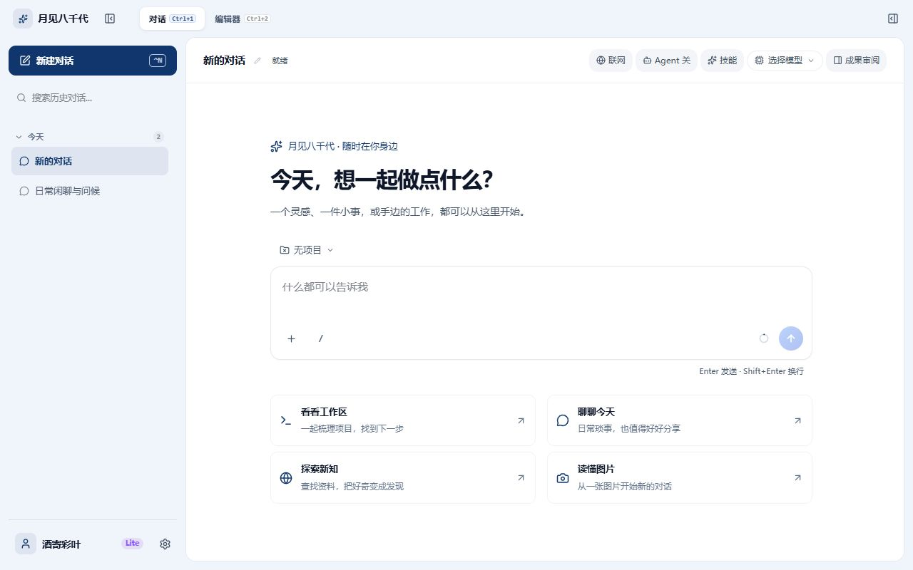

# Yachiyo Chat Desktop

[](https://github.com/liangcka/Yachiyo-chat-desktop/actions/workflows/ci.yml)
[](LICENSE)

Yachiyo Chat Desktop 是围绕动画电影《超时空辉夜姬》（超かぐや姫！）角色「月见八千代」构建的桌面对话与开发工作区，面向 Windows 原生桌面和 PC 浏览器使用。

前端统一采用桌面布局：左侧管理会话，中间切换对话与编辑器，右侧查看代码审阅、预览、成果工件和工作区。界面采用中性灰阶配色与品牌蓝强调色，支持明暗模式与中日双语，通过间距与轻边框组织内容。首次发送消息时，输入区从欢迎页平滑移至底部；系统启用“减少动态效果”时直接就位。

Tauri v2 与 Rust 提供原生桌面窗口、本地网关和工作区工具；PC 浏览器版本通过 Cloudflare Pages Functions 提供对话接口。移动版界面和右下角 Live2D 挂件已移除，`android/` 与 `capacitor.config.ts` 作为历史原生工程保留，不属于当前 UI 交付范围。

> [!NOTE]
> **文档入口**：[桌面使用指南](docs/DESKTOP_GUIDE.md)、[运行时与隔离边界](docs/ARCHITECTURE_ISOLATION.md)、[贡献指南](CONTRIBUTING.md)。本地开发可使用 `npm run desktop:dev` 启动 Tauri，或使用 `npm run dev:mock` 启动带后端的 PC 浏览器预览。

---

## 桌面界面



项目的角色陪伴概念源于《超かぐや姫！》ray MV 中的日常交流场景。当前产品围绕桌面端的对话、代码编辑和工作区协作展开。

---

## 核心功能与架构特性

### 1. 沉浸式一体化桌面端 (Tauri v2 + Rust)

- **桌面顶栏**：集成品牌、侧栏折叠、对话 / 编辑器切换与成果面板入口；Tauri 窗口额外提供原生最小化、最大化和关闭操作。
- **本地 Rust 网关 (Axum Gateway)**：桌面端内置高性能 Rust 本地服务，提供统一流式代理与客户端事件广播，支持离线或本地直连各大厂商 API。
- **项目工作区管理**：原生支持选择本地工程目录，双端状态强一致同步。

### 2. 桌面端 IDE Agent 模式 (对齐 DSH 工业级规范)

针对长会话、复杂重构与代码审查场景，系统实现了完整的智能体工具循环，并严格对齐 DeepSeek Harness (DSH) 工业级工程规范：

- **无模型工具结果智能修剪 (Tool Result Pruner)**：
  对齐 DSH `compaction-tool-result-pruner` 规范。当单项工具调用输出（如读取大型文件或命令日志）超过 8192 字符预算时，自动保留头部与尾部关键信息并以无模型方式折叠中间冗余，有效防止上下文与 Token 膨胀，保护上游 LLM 的 KV-Cache 命中率。同时保持前端与持久化存储中的原始完整数据，做到审查零失真。
- **文件系统观察守卫 (FS Observation Policy)**：
  对齐 DSH `fs-observation-policy` 规范。会话级追踪文件读取状态与修改时间戳（mtime）。在写入文件前强制要求先读后写，杜绝未读盲写破坏代码；并在写入时进行 CAS 版本校验，若文件在读取后被外部进程修改则自动拦截并提示重读，避免冲突覆盖。
- **任务进度清单与 Plan Strip (Tool Todo)**：
  对齐 DSH `tool-todo` 规范。提供 `todo_write` 工具，支持模型自主将复杂多步任务拆解为清单；前端在输入框上方提供具备呼吸灯高亮、展开/折叠与完成度统计的星空玻璃任务进度条（Plan Strip）。
- **超大工具输出落地与引导 (Spill Policy)**：
  对齐 DSH `spill-policy` 规范。当命令输出超过阈值时，自动将完整日志写入本地 `.yachiyo/spill/` 目录，并向模型返回双向检索指引。
- **工作区深度感知与主动探索准则 (Action-first)**：
  系统动态扫描工作区顶层文件与工程结构注入上下文；当用户提出「这是什么」、「分析项目」等疑问时，模型遵循主动探索准则，优先自主调用工具查阅实际代码与说明文档，杜绝凭空捏造事实。

### 3. 月见八千代 角色交互与情感陪伴

- **人设还原与流式交互**：八千代拥有贯通岁月长河的记忆人设，回复带括号动作心理描写，支持随时中断生成并保留已生成内容。
- **深度思考可视化 (ThinkingBlock)**：全面支持 DeepSeek R1、Claude、Gemini 等模型的推理思维链（`reasoning_content` / thinking），提供折叠展示、思考耗时统计与平滑流式展开。
- **两阶平滑智能会话命名**：
  首轮对话完成后立即采用启发式零延迟命名更新界面；随后在后台异步调度大模型进行主题提炼，概括讨论核心并过滤客套前缀，实现平滑升级与历史孤儿会话全链路自愈。
- **本地个性化资料与圆形头像裁剪**：
  完全保存在本地的个性化配置（用户名与头像）。集成大视口、无黑边全覆盖算法的圆形头像裁剪器，支持缩放、拖拽与顺时针旋转，并将用户名自然注入对话前置元数据。
- **长期记忆与可组合技能**：
  内置记忆管理面板；提供深度思维、情感洞察、精准事实、知识条理与 Humanizer（真人文风去 AI 味）五项可组合技能。

### 4. 多厂商 LLM 路由矩阵

支持国内与国际六大厂商自由切换，个人 API Key 仅保存在本地客户端，双端无缝支持流式回复与视觉识图（Vision）：

| 分组 | 厂商 | 模型支持 | 视觉模型 |
| ---- | ---- | -------- | -------- |
| 国内 | 阶跃星辰 StepFun | step-3.7-flash, step-plan 等 | 支持 |
| 国内 | DeepSeek | deepseek-v4-flash, deepseek-v4-pro 等 | 支持 |
| 国内 | 智谱 GLM | glm-5.3, glm-4.6v-flash 等 | 支持 |
| 国际 | OpenAI | gpt-5.6-sol, gpt-5.5 等 | 支持 |
| 国际 | Anthropic | claude-opus-5-5, claude-sonnet-5-5 等 | 支持 |
| 国际 | Google Gemini | gemini-3.1-pro, gemini-3.7-flash 等 | 支持 |

### 5. DSH 联网搜索管道 (WebRuntime Router)

基于 DeepSeek Harness 的 `packages/web/` 模块规范设计：

- **智能意图门控与多词提取**：自动判断是否需要联网，并提取去除停用词的精炼关键词。
- **统一级联容灾路由**：
  支持 DeepSeek 搜索、Exa 神经搜索、Tavily 事实搜索、Perplexity、Brave、博查、SearXNG、Google 自定义搜索、Jina AI 语义搜索，以及基于 Bing / DuckDuckGo 的免 Key 多路轮询兜底。
- **SearchSieve 证据清洗与正文抓取**：自动过滤黑名单与低质站点；对 Top 3 结果并行抓取正文段落注入系统上下文，参考来源随消息持久化保存。

---

## 技术栈

| 层次 | 技术选型 | 说明 |
| ---- | -------- | ---- |
| 桌面端核心 | Tauri v2、Rust、Axum、Tokio | 无边框窗口、原生网关、本地工具集 |
| 前端框架 | React 19、TypeScript、Vite | 现代化响应式界面、严格类型 |
| 渲染与列表 | TanStack Virtual | 长消息列表高性能虚拟化滚动 |
| 本地存储 | Dexie.js (IndexedDB)、localStorage | 聊天历史、长期记忆、本地用户设置 |
| PWA / 离线 | Workbox (vite-plugin-pwa) | 离线只读缓存、应用级安装 |
| 云端边缘 | Cloudflare Pages Functions、Workers KV | 边缘 API 中间件、会话鉴权、速率控制 |
| 历史原生工程 | Capacitor 8 (Android) | 保留原生文件与依赖，不提供独立移动版界面 |
| 自动化测试 | Vitest、Testing Library、Playwright | 单元测试、云函数测试、桌面端集成测试 |

---

## 下载安装

普通用户无需搭建开发环境：

1. 在 [Releases](https://github.com/liangcka/Yachiyo-chat-desktop/releases) 下载最新的 Windows 安装包（`.exe` 或 `.msi`）。
2. 安装包暂未进行代码签名，首次运行时 Windows SmartScreen 可能提示“已保护你的电脑”，点击“更多信息 → 仍要运行”即可。
3. 首次启动后，在欢迎页点击“配置模型”（或左下角“设置 → 模型”），填写任一厂商的个人 API Key 并选择模型，即可开始对话。
4. API Key 仅保存在本机：Windows 下使用系统 DPAPI 按当前登录用户加密，不会上传到任何服务器。

应用启动时会检查 GitHub 上是否有新版本，发现更新时在界面中提示下载地址。

---

## 快速开始（开发者）

### 环境准备

- Node.js 22.12 或更高版本
- Rust 稳定版编译器与 Cargo（仅桌面端开发需要）
- npm 包管理器

### 安装依赖

```bash
git clone https://github.com/liangcka/Yachiyo-chat-desktop.git
cd Yachiyo-chat-desktop
npm install
```

### 运行方式

#### 1. 桌面端开发 (推荐)

启动基于 Tauri v2 的原生桌面开发环境：

```bash
npm run desktop:dev
```

#### 2. 本地 Mock 联调 (前端 + 本地 Pages Functions)

启动内置 Cloudflare Pages Functions 与本地 KV 模拟的环境，支持免配置完整体验：

```bash
npm run dev:mock
```

访问控制台输出的本地 URL 即可。开发环境使用 `yachiyo-local-access` 自动建立会话，无需手动输入访问码。

#### 3. 生产完整联调

```bash
npm run dev:pages
```

---

## 常用脚本命令

| 命令 | 用途说明 |
| ---- | -------- |
| `npm run desktop:dev` | 启动桌面端 Tauri 开发窗口 |
| `npm run desktop:build` | 编译生成桌面端 Release 可执行程序 |
| `npm run dev:mock` | 本地 Mock 联调（内置 Pages Functions 与 KV 模拟） |
| `npm run dev:pages` | 本地完整 Pages 联调（需配置相关环境变量） |
| `npm run build` | 生产构建（自动执行提示词同步与严格类型检查） |
| `npm run sync:prompt` | 同步角色提示词至云函数自动生成代码 |
| `npm run typecheck` | 对 app、node 与 functions 执行三份 tsconfig 全量类型检查 |
| `npm run lint` | ESLint 静态代码风格与规范检查 |
| `npm run test:unit` | 前端组件与业务逻辑单元测试 |
| `npm run test:functions` | Cloudflare Pages Functions 云函数测试 |
| `npm run test:desktop` | 桌面端 Rust 单元与集成测试 |
| `npm test` | 串行运行单元测试、云函数测试与桌面端测试 |

---

## 质量门禁与工程规范

项目遵循严格的工程行为准则（Think Before Coding, Simplicity First, Surgical Changes, Goal-Driven Execution）。

在提交代码前，请执行基线质量门禁：

```bash
npm run typecheck
npm run lint
npm run test:unit
npm run test:functions
cargo test --manifest-path src-tauri/Cargo.toml
```

### 移动端隔离规则

除明确指令要求修改移动端外，严禁修改 `android/` 目录下的任何原生代码、清单、Gradle 脚本以及顶层 `capacitor.config.ts`。所有日常功能演进均以 PC 桌面端（Tauri）与 Web PWA 为准。

---

## 隐私与安全边界

1. **本地数据绝对优先**：
   所有的聊天记录、长期记忆、图片、自定义用户名与个人头像均严格保存在当前设备的 IndexedDB 与 localStorage 中。服务端不持久化任何聊天正文或用户图片。
2. **凭据安全隔离**：
   用户在客户端填写的个人 API Key 仅保存在本地设备，调用请求直连厂商（桌面端）或随同源请求临时转发（Web 端），不存储于云端数据库。
3. **边缘防护与配额**：
   云函数接口具备 Cloudflare Workers KV 频控限制；桌面端执行系统命令具备安全白名单校验与危险指令拦截（如危险系统级删除指令）。

---

## 参与贡献

欢迎提交 Issue 与 Pull Request 协助改进项目。

- 代码规范与决策记录请参考 `.agents/notes/` 目录；
- 安全漏洞反馈请参阅 [SECURITY.md](SECURITY.md)；
- 贡献流程与代码提交守则请参考 [CONTRIBUTING.md](CONTRIBUTING.md)。

---

## 声明

- 本项目为非官方同人作品，与《超かぐや姫！》（超时空辉夜姬）的版权方及制作方无关。角色「月见八千代」「酒寄彩叶」及相关设定的著作权归原权利人所有。
- 仓库中的角色设定与提示词仅供学习交流与非商业用途；如权利人认为存在不当使用，请通过 Issue 联系，我们会及时处理。
- Apache License 2.0 仅适用于本项目原创的源代码，不授予任何第三方角色、名称或素材的使用权。

---

## 许可证

本项目采用 [Apache License 2.0](LICENSE) 许可证分发与使用。
